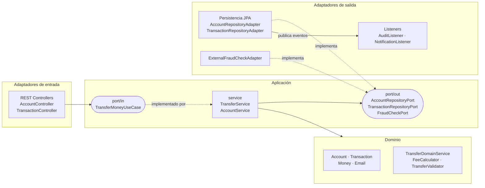
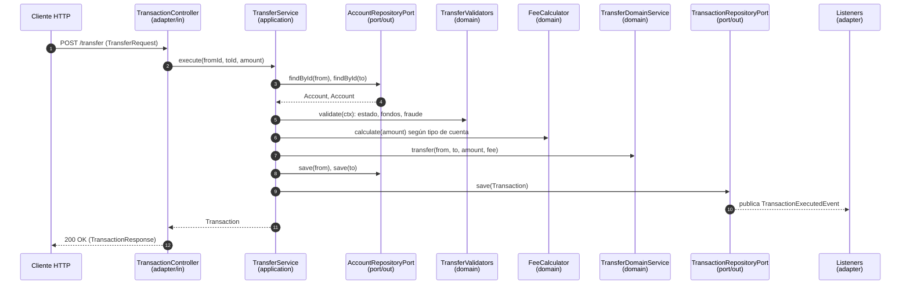

# Arquitectura Hexagonal en Atlas Bank

Guía de referencia para entender cómo está organizado este proyecto y dónde va cada pieza de código nuevo.

---

## Índice

1. [¿Qué es la Arquitectura Hexagonal?](#1-qué-es-la-arquitectura-hexagonal)
2. [Vista general del proyecto](#2-vista-general-del-proyecto)
3. [Las tres capas](#3-las-tres-capas)
4. [Árbol de carpetas](#4-árbol-de-carpetas)
5. [Puertos y adaptadores con código real](#5-puertos-y-adaptadores-con-código-real)
6. [Recorrido de una petición: una transferencia](#6-recorrido-de-una-petición-una-transferencia)
7. [Tres representaciones de una cuenta](#7-tres-representaciones-de-una-cuenta)
8. [Patrones de diseño que conviven](#8-patrones-de-diseño-que-conviven)
9. [¿Dónde pongo...? Guía rápida](#9-dónde-pongo-guía-rápida)
10. [Decisiones pragmáticas y pendientes](#10-decisiones-pragmáticas-y-pendientes)

---

## 1. ¿Qué es la Arquitectura Hexagonal?

También se conoce como **Puertos y Adaptadores** (*Ports & Adapters*, Alistair Cockburn).

La idea central es una sola:

> **La lógica de negocio está en el centro y no sabe nada del mundo exterior.**
> Ni de HTTP, ni de la base de datos, ni de servicios externos.

Para comunicarse con el exterior usa dos conceptos:

| Concepto | Qué es | En Java es... |
|---|---|---|
| **Puerto** | Un "enchufe": define *qué* se necesita o *qué* se ofrece, sin decir *cómo*. | Una `interface` |
| **Adaptador** | Lo que se conecta al enchufe: implementa el *cómo* con una tecnología concreta. | Una clase que implementa o usa esa `interface` |

Hay dos tipos de puertos:

- **Puertos de entrada** (*driving*, `port/in`): lo que la aplicación **ofrece**. Ejemplo: "transferir dinero". Los usa un controller REST, un job, un test...
- **Puertos de salida** (*driven*, `port/out`): lo que la aplicación **necesita**. Ejemplo: "guardar una cuenta". Los implementa un adaptador JPA, un cliente HTTP...

### La regla de oro: las dependencias apuntan hacia adentro

```
infrastructure  ──►  application  ──►  domain
```

- `domain` no importa nada de `application` ni de `infrastructure`.
- `application` no importa nada de `infrastructure`.
- `infrastructure` puede importar de todo.

**¿Qué se gana?** Puedes cambiar PostgreSQL por MongoDB, REST por GraphQL o el proveedor antifraude **sin tocar la lógica de negocio**: solo escribes otro adaptador.

---

## 2. Vista general del proyecto



Flechas sólidas = "usa / llama a". Flechas punteadas = "implementa".

---

## 3. Las tres capas

Resumen de las reglas de oro de cada capa:

| Capa | Regla de oro | Puede depender de | Nunca debe depender de |
|---|---|---|---|
| `domain` | **Código puro de negocio** | Solo Java estándar (y sus propias clases) | `application`, `infrastructure`, HTTP, JPA, servicios externos |
| `application` | **Orquesta, no decide** | `domain` | `infrastructure`, HTTP, JPA |
| `infrastructure` | **Traduce, no decide** | `application` y `domain` | Nadie depende de ella |

### 3.1 `domain/`: el corazón del negocio

> 🟢 **Regla de oro: el dominio es código puro.**
> Solo Java y conceptos de negocio. No conoce HTTP, base de datos, JSON ni frameworks.
> Debe poder probarse con un simple `new Account(...)` y JUnit, **sin levantar Spring**.

Contiene las reglas que existirían aunque no hubiera software: una cuenta no puede quedar en negativo, una transferencia cobra comisión según el tipo de cuenta, etc.

**✅ Sí va aquí:** entidades con comportamiento (`Account.withdraw()`), value objects (`Money`), reglas, validaciones de negocio, eventos y excepciones de negocio.
**❌ No va aquí:** `@Entity`, `@RestController`, `ResponseEntity`, DTOs, repositorios JPA, llamadas HTTP, `@Transactional`.

> ⚠️ En este proyecto el dominio todavía usa `@Component`, `@Service` y `@Order` de Spring por simplicidad. Ver la [sección 10](#10-decisiones-pragmáticas-y-pendientes).

| Paquete | Contenido | Ejemplos |
|---|---|---|
| `model/account` | Entidad Cuenta y sus enums | `Account` (tiene `withdraw()` y `deposite()`), `AccountType`, `AccountStatus` |
| `model/customer` | Entidad Cliente | `Customer`, `CustomerStatus` |
| `model/transaction` | Entidad Transacción y su ciclo de vida | `Transaction`, `TransferContext`, `state/*` (`PendingState`, `ExecutedState`...) |
| `model/shared` | Value Objects reutilizables | `Money`, `Email`, `Currency`, `FraudCheckResult` |
| `service` | Lógica que involucra a varias entidades | `TransferDomainService` (retira de una cuenta y deposita en otra) |
| `strategy/fee` | Cálculo de comisiones por tipo de cuenta | `FeeCalculator`, `SavingsFeeCalculator`, `CheckingFeeCalculator`... |
| `validation` | Reglas que debe cumplir una transferencia | `AccountStatusValidator`, `SufficientFundsValidator`, `FraudValidator` |
| `factory` | Creación de objetos de dominio complejos | `TransactionFactory` |
| `event` | Hechos de negocio que ya ocurrieron | `TransactionExecutedEvent` |
| `exception` | Errores de negocio | `InsufficientFundsException`, `AccountNotFoundException`... |

> **Pregunta para validar:** "¿Esta clase cambiaría si cambio de base de datos o de framework web?" Si la respuesta es **sí**, no va en `domain`.

### 3.2 `application/`: los casos de uso

> 🔵 **Regla de oro: la aplicación orquesta, no decide.**
> Coordina los pasos de un caso de uso (buscar, validar, ejecutar, guardar), pero las **decisiones de negocio las toma el dominio**.
> Habla con el exterior **solo a través de puertos** (interfaces); nunca conoce la implementación concreta.

Orquesta el dominio para cumplir una necesidad concreta del usuario: busca datos, llama al dominio y guarda resultados.

**✅ Sí va aquí:** puertos de entrada y salida, servicios de caso de uso, manejo de transacciones (`@Transactional`), decoradores como auditoría o caché.
**❌ No va aquí:** `if (saldo < monto)` y otras reglas de negocio (van en `domain`), imports de `infrastructure`, `JpaRepository`, DTOs de la API.

> **Señal de alerta:** si un servicio de aplicación tiene muchos `if` con reglas del negocio, esa lógica probablemente pertenece al dominio.

| Paquete | Contenido | Ejemplos |
|---|---|---|
| `port/in` | Lo que la aplicación ofrece al exterior | `TransferMoneyUseCase`, `CreateAccountUseCase` |
| `port/out` | Lo que la aplicación necesita del exterior | `AccountRepositoryPort`, `TransactionRepositoryPort`, `FraudCheckPort` |
| `service/account` | Casos de uso de cuentas | `AccountService`, `AuditableAccountService`, `CachedAccountService` |
| `service/transaction` | Casos de uso de transacciones | `TransferService`, `TransactionProcessor`, `TransactionQueryService` |

### 3.3 `infrastructure/`: el mundo exterior

> 🟠 **Regla de oro: la infraestructura traduce, no decide.**
> Convierte el mundo exterior (JSON, tablas, APIs externas) en objetos del dominio y viceversa.
> Es la capa **más reemplazable**: cambiar de tecnología solo debería tocar esta capa.

Todo lo que depende de una tecnología: Spring MVC, JPA, servicios externos, configuración.

**✅ Sí va aquí:** controllers, DTOs, mappers, entidades JPA, repositorios Spring Data, clientes HTTP, listeners, configuración y manejo de errores HTTP.
**❌ No va aquí:** reglas de negocio. Un controller no calcula comisiones y un adaptador JPA no valida saldos.

> **Señal de alerta:** si un controller o adaptador tiene lógica que cambiaría al cambiar una regla del banco, esa lógica está en la capa equivocada.

| Paquete | Rol | Contenido |
|---|---|---|
| `adapter/in/rest/controller` | Adaptador de **entrada** | `AccountController`, `TransactionController` |
| `adapter/in/rest/dto/request` | Lo que llega por HTTP | `CreateAccountRequest`, `TransferRequest` |
| `adapter/in/rest/dto/response` | Lo que sale por HTTP | `AccountResponse`, `TransactionResponse`, `DashboardResponse` |
| `adapter/in/rest/mapper` | DTO ⇄ dominio (MapStruct) | `AccountMapper`, `TransactionMapper` |
| `adapter/in/rest/facade` | Combina varios servicios para una vista | `AccountDashboardFacade` |
| `adapter/in/rest/validation` | Validaciones de formato del request | `@DifferentAccounts`, `DifferentAccountsValidator` |
| `adapter/out/persistence/entity` | Tablas de la BD (`@Entity`) | `AccountJpaEntity`, `TransactionJpaEntity`, `CustomerJpaEntity` |
| `adapter/out/persistence/repository` | Spring Data JPA | `AccountRepository`, `TransactionRepository` |
| `adapter/out/persistence/mapper` | Entidad JPA ⇄ dominio | `AccountPersistenceMapper`, `TransactionPersistenceMapper` |
| `adapter/out/persistence/adapter` | Adaptador de **salida**: implementa los puertos | `AccountRepositoryAdapter`, `TransactionRepositoryAdapter` |
| `adapter/out/fraud` | Adaptador de **salida** al servicio antifraude | `ExternalFraudCheckAdapter` |
| `adapter/listener` | Reaccionan a eventos de dominio | `AuditListener`, `NotificationListener` |
| `config` | Configuración transversal | `SecurityConfig`, `CacheConfig`, `GlobalExceptionHandler` |

---

## 4. Árbol de carpetas

```
com.atlas.bank.atlas_bank
├── domain/                         ← NO depende de nadie
│   ├── model/{account,customer,transaction,shared}
│   ├── service/
│   ├── strategy/fee/
│   ├── validation/
│   ├── factory/
│   ├── event/
│   └── exception/
│
├── application/                    ← depende solo de domain
│   ├── port/
│   │   ├── in/                     ← lo que OFRECEMOS
│   │   └── out/                    ← lo que NECESITAMOS
│   └── service/{account,transaction}
│
└── infrastructure/                 ← depende de application y domain
    ├── adapter/
    │   ├── in/rest/                ← HTTP entra aquí
    │   │   ├── controller/
    │   │   ├── dto/{request,response}
    │   │   ├── mapper/
    │   │   ├── facade/
    │   │   └── validation/
    │   ├── out/
    │   │   ├── persistence/        ← la BD sale por aquí
    │   │   │   ├── entity/
    │   │   │   ├── repository/
    │   │   │   ├── mapper/
    │   │   │   └── adapter/
    │   │   └── fraud/              ← servicio externo
    │   └── listener/
    └── config/
```

---

## 5. Puertos y adaptadores con código real

### 5.1 Puerto de entrada: `TransferMoneyUseCase`

**El puerto** (`application/port/in/TransferMoneyUseCase.java`) dice *qué* se puede hacer:

```java
public interface TransferMoneyUseCase {
    Transaction execute(Long fromId, Long toId, BigDecimal amount);
}
```

**Quien lo usa** es el adaptador de entrada REST (`TransactionController`). Fíjate que depende de la **interfaz**, no de `TransferService`:

```java
@RestController
@RequestMapping("/api/v1/transactions")
public class TransactionController {

    private final TransferMoneyUseCase transferMoneyUseCase;

    @PostMapping("/transfer")
    public ResponseEntity<TransactionResponse> transfer(@Valid @RequestBody TransferRequest request) {
        Transaction transaction = transferMoneyUseCase.execute(
                request.getFromAccountId(), request.getToAccountId(), request.getAmount());
        return ResponseEntity.ok(transactionMapper.toResponse(transaction));
    }
}
```

**Quien lo implementa** es el servicio de aplicación `TransferService`.

### 5.2 Puerto de salida: `AccountRepositoryPort`

**El puerto** (`application/port/out/AccountRepositoryPort.java`) dice *qué* necesita la aplicación, usando **objetos de dominio**:

```java
public interface AccountRepositoryPort {
    List<Account> findAll();
    Optional<Account> findById(Long id);
    Account save(Account account);
}
```

**El adaptador** (`infrastructure/adapter/out/persistence/adapter/AccountRepositoryAdapter.java`) lo implementa con JPA y traduce entre dominio y entidad:

```java
@Repository
public class AccountRepositoryAdapter implements AccountRepositoryPort {

    private final AccountRepository accountRepository;   // Spring Data JPA
    private final AccountPersistenceMapper mapper;       // dominio ⇄ JPA

    @Override
    public Optional<Account> findById(Long id) {
        return accountRepository.findById(id).map(mapper::toDomain);
    }

    @Override
    public Account save(Account account) {
        AccountJpaEntity saved = accountRepository.save(mapper.toJpaEntity(account));
        return mapper.toDomain(saved);
    }
}
```

`TransferService` solo conoce `AccountRepositoryPort`. **No sabe que existe JPA.**

### 5.3 Puerto de salida a un servicio externo: `FraudCheckPort`

```java
public interface FraudCheckPort {
    FraudCheckResult check(Long accountId, BigDecimal amount);
}
```

`ExternalFraudCheckAdapter` lo implementa llamando (simuladamente) a una API externa y traduce su respuesta (`ExternalFraudResponse`) a un objeto del dominio (`FraudCheckResult`).

> **Ventaja práctica:** si mañana el banco contrata otro proveedor antifraude, se crea `OtroProveedorFraudAdapter implements FraudCheckPort` y **nada más cambia**.

---

## 6. Recorrido de una petición: una transferencia

`POST /api/v1/transactions/transfer`

```json
{ "fromAccountId": 1, "toAccountId": 2, "amount": 500.00 }
```



Paso a paso:

1. **Entrada**: `TransactionController` recibe el JSON como `TransferRequest`. `@DifferentAccounts` valida que origen y destino sean distintos.
2. **Caso de uso**: el controller llama a `TransferMoneyUseCase.execute(...)`; la implementación es `TransferService`.
3. **Carga de datos**: `TransferService` obtiene ambas cuentas mediante `AccountRepositoryPort`. Si no existen, lanza `AccountNotFoundException`.
4. **Plantilla del proceso**: `TransactionProcessor.process()` define el orden fijo: **validar → calcular comisión → ejecutar → guardar**.
5. **Validar**: se ejecutan en orden `AccountStatusValidator` (1), `SufficientFundsValidator` (2) y `FraudValidator` (3). Este último consulta `FraudCheckPort`.
6. **Comisión**: se elige el `FeeCalculator` que soporta el tipo de la cuenta origen (ahorro, cheques, premium...).
7. **Regla de negocio**: `TransferDomainService.transfer()` llama a `from.withdraw()` y `to.deposite()`. Si no alcanza el saldo, el propio `Account` lanza `InsufficientFundsException`.
8. **Persistencia**: se guardan las cuentas y la transacción (creada por `TransactionFactory`) a través de los puertos de salida.
9. **Eventos**: `TransactionRepositoryAdapter` publica los eventos de dominio acumulados en `Transaction`; `AuditListener` y `NotificationListener` reaccionan.
10. **Salida**: `TransactionMapper` convierte la `Transaction` en `TransactionResponse`. Si algo falló, `GlobalExceptionHandler` traduce la excepción de dominio a un código HTTP.

---

## 7. Tres representaciones de una cuenta

Una misma "cuenta" existe en tres formas, una por frontera. Es intencional.

| Clase | Capa | Para qué sirve | Ejemplo de diferencia |
|---|---|---|---|
| `AccountResponse` / `CreateAccountRequest` | `infrastructure/adapter/in/rest/dto` | Contrato de la API (JSON) | `balance` es un `BigDecimal`, `email` es un `String` |
| `Account` | `domain/model/account` | Reglas de negocio | `balance` es `Money`, `email` es `Email`; tiene `withdraw()` |
| `AccountJpaEntity` | `infrastructure/adapter/out/persistence/entity` | Mapeo a la tabla | Anotaciones `@Entity`, `@Column`, embeddables JPA |

```
JSON  ⇄  AccountMapper  ⇄  Account  ⇄  AccountPersistenceMapper  ⇄  AccountJpaEntity  ⇄  BD
        (adapter/in)        (domain)          (adapter/out)
```

**¿Por qué no usar una sola clase?** Porque cambiar el nombre de una columna no debería romper la API, y agregar un campo a la API no debería obligar a modificar el dominio.

---

## 8. Patrones de diseño que conviven

La arquitectura hexagonal organiza las **capas**; dentro de ellas se aplican patrones clásicos:

| Patrón | Dónde | Para qué |
|---|---|---|
| **Strategy** | `domain/strategy/fee/*FeeCalculator` | Una comisión distinta por tipo de cuenta |
| **Chain of Responsibility** | `domain/validation/*Validator` (con `@Order`) | Validaciones encadenadas e independientes |
| **Template Method** | `application/service/transaction/TransactionProcessor` | Fija el orden validar → comisión → ejecutar → guardar |
| **State** | `domain/model/transaction/state/*` | Ciclo de vida de la transacción (pendiente, ejecutada, rechazada...) |
| **Decorator** | `AuditableAccountService`, `CachedAccountService` | Agregan auditoría o caché alrededor de `AccountService` |
| **Factory** | `domain/factory/TransactionFactory` | Construye transacciones válidas |
| **Facade** | `adapter/in/rest/facade/AccountDashboardFacade` | Une cuenta + transacciones en una sola respuesta |
| **Observer** | `TransactionExecutedEvent` → `AuditListener`, `NotificationListener` | Efectos secundarios desacoplados |
| **Value Object** | `Money`, `Email` | Valores inmutables y autovalidados |

---

## 9. ¿Dónde pongo...? Guía rápida

| Quiero... | Pasos |
|---|---|
| **Un nuevo endpoint** | 1. Puerto en `application/port/in` · 2. Implementación en `application/service` · 3. DTOs en `adapter/in/rest/dto` y mapper en `adapter/in/rest/mapper` · 4. Método en el controller que use el **puerto** |
| **Una nueva regla de negocio** | Si pertenece a una entidad, como un método en ella (ej. `Account.withdraw`). Si involucra varias, en `domain/service`. Si es una validación de transferencia, una nueva clase que implemente `TransferValidator` |
| **Un nuevo tipo de comisión** | Nueva clase que implemente `FeeCalculator` en `domain/strategy/fee` |
| **Integrar un servicio externo** | 1. Puerto en `application/port/out` con tipos de dominio · 2. Adaptador en `infrastructure/adapter/out/<nombre>` que lo implemente |
| **Una nueva tabla** | 1. Modelo en `domain/model` · 2. `@Entity` en `persistence/entity` · 3. Spring Data en `persistence/repository` · 4. Mapper en `persistence/mapper` · 5. Puerto en `port/out` + adaptador en `persistence/adapter` |
| **Reaccionar a algo que pasó** | Evento en `domain/event` y un listener en `infrastructure/adapter/listener` |
| **Traducir una excepción a HTTP** | Handler en `infrastructure/config/GlobalExceptionHandler` |

**Checklist antes de hacer commit:**

- [ ] ¿Algo en `domain` importa `org.springframework.web`, `jakarta.persistence` o `infrastructure`? → mal ubicado.
- [ ] ¿Algo en `application` importa `infrastructure`? → falta un puerto.
- [ ] ¿El controller depende de una clase concreta en vez de una interfaz de `port/in`? → usa el puerto.
- [ ] ¿Un `@Entity` o un DTO llegó al dominio? → falta un mapper.

---

## 10. Decisiones pragmáticas y pendientes

Este proyecto está **en migración** hacia la arquitectura hexagonal. Lo siguiente es conocido y conviene **no copiarlo** como modelo ideal:

| Situación | Por qué no es "puro" | Mejora sugerida |
|---|---|---|
| El dominio usa `@Component`, `@Service`, `@Order` de Spring y Lombok | El dominio depende de un framework | Aceptable por simplicidad. Para pureza total, registrar los beans en una clase `@Configuration` de `infrastructure/config` |
| `domain/validation/FraudValidator` importa `application.port.out.FraudCheckPort` | El dominio depende de la capa de aplicación (dependencia hacia afuera) | Mover `FraudValidator` a `application`, o mover la interfaz del puerto al dominio |
| `ITransferService` duplica a `TransferMoneyUseCase` | Dos interfaces para lo mismo | Eliminar `ITransferService` |
| `CreateAccountUseCase` no lo implementa nadie | Puerto sin uso | Que `AccountService` lo implemente |
| `AccountController` y `AccountDashboardFacade` usan `IAccountService` / `ITransactionQueryService` | Dependen de servicios, no de puertos de entrada | Crear puertos de consulta (ej. `GetAccountUseCase`) y eliminar las interfaces `I*Service` |
| `CachedAccountService` y `AuditableAccountService` tienen `@Primary` | Si se activa `atlas.account.cache.enabled=true` hay dos beans primarios y la app no arranca | Encadenar los decoradores explícitamente con `@Qualifier`. `CachedAccountService` se conserva como ejemplo del patrón Decorator |
| `FraudChecker` (interfaz anterior) convive con `FraudCheckPort` | Restos de la versión previa | Eliminar `FraudChecker` cuando nada lo use |
| Los eventos se publican desde `TransactionRepositoryAdapter` | La publicación de eventos queda acoplada a la persistencia | Publicarlos desde el servicio de aplicación mediante un `DomainEventPublisherPort` |
