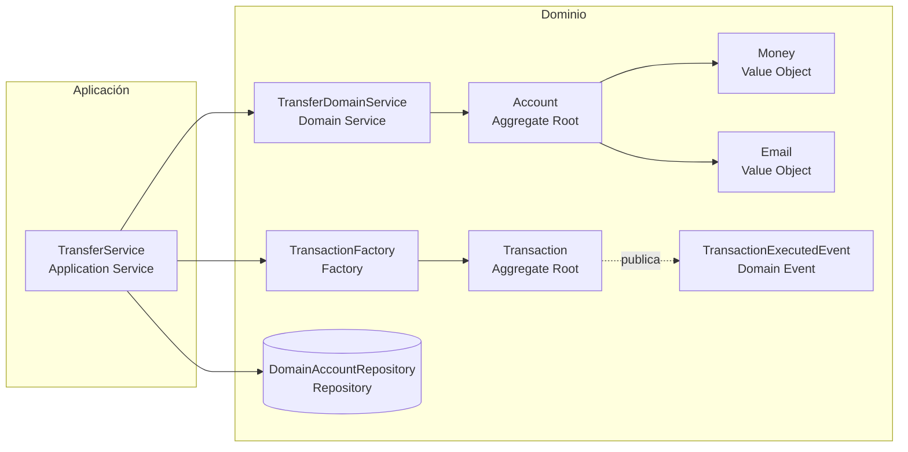
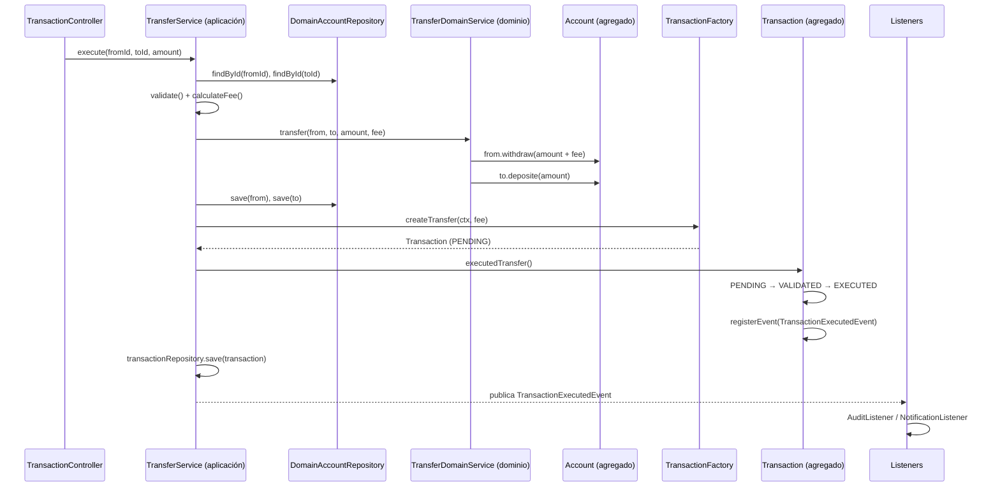

# Domain-Driven Design (DDD) en Atlas Bank

> Guía de referencia para entender qué es DDD, por qué se aplica y **cómo se ve en el código de este repositorio**.
> Cada concepto apunta a una clase real del proyecto para que puedas abrirla y compararla.

---

## Índice

1. [¿Qué es DDD en una frase?](#1-qué-es-ddd-en-una-frase)
2. [El problema que resuelve: modelo anémico vs. modelo rico](#2-el-problema-que-resuelve-modelo-anémico-vs-modelo-rico)
3. [DDD estratégico: lenguaje y contextos](#3-ddd-estratégico-lenguaje-y-contextos)
4. [DDD táctico: los bloques de construcción](#4-ddd-táctico-los-bloques-de-construcción)
   - [4.1 Value Object](#41-value-object-objeto-de-valor)
   - [4.2 Entity](#42-entity-entidad)
   - [4.3 Aggregate y Aggregate Root](#43-aggregate-y-aggregate-root)
   - [4.4 Repository](#44-repository-repositorio)
   - [4.5 Domain Service](#45-domain-service-servicio-de-dominio)
   - [4.6 Domain Event](#46-domain-event-evento-de-dominio)
   - [4.7 Factory](#47-factory-fábrica)
   - [4.8 Application Service](#48-application-service-servicio-de-aplicación)
5. [Recorrido completo: una transferencia de punta a punta](#5-recorrido-completo-una-transferencia-de-punta-a-punta)
6. [Reglas de oro](#6-reglas-de-oro)
7. [Áreas de mejora detectadas en el proyecto](#7-áreas-de-mejora-detectadas-en-el-proyecto)
8. [Checklist para nuevo código](#8-checklist-para-nuevo-código)
9. [Glosario rápido](#9-glosario-rápido)

---

## 1. ¿Qué es DDD en una frase?

**Domain-Driven Design es poner las reglas del negocio en el centro del código**, escritas con las mismas palabras que usa el negocio, y proteger esas reglas para que nadie pueda saltárselas.

En un banco, las reglas son cosas como:

- "No puedes retirar más dinero del que tienes."
- "No se pueden sumar pesos con dólares."
- "Una transacción ejecutada no se puede volver a ejecutar."

DDD dice: **esas reglas deben vivir dentro de los objetos del dominio** (`Account`, `Money`, `Transaction`), no dispersas en controladores, servicios o validadores.

DDD tiene dos caras:

| Cara | Pregunta que responde | Ejemplos |
|---|---|---|
| **Estratégica** | ¿Cómo divido el sistema y de qué hablamos? | Lenguaje ubicuo, Bounded Contexts |
| **Táctica** | ¿Cómo escribo el código dentro de cada parte? | Entity, Value Object, Aggregate, Repository, Domain Service, Domain Event |

Este proyecto se enfoca principalmente en la **táctica** (rama `seccion-7-domain-driven-design-tactico`).

---

## 2. El problema que resuelve: modelo anémico vs. modelo rico

### ❌ Modelo anémico (antes)

Una clase que solo tiene datos y *getters/setters*. Toda la lógica vive en un servicio:

```java
// El servicio hace todo; Account es una "bolsa de datos"
BigDecimal nuevoSaldo = from.getBalance().subtract(amount.add(fee));
from.setBalance(nuevoSaldo);
to.setBalance(to.getBalance().add(amount));
```

Problemas:

- La regla "no retirar más de lo que hay" puede olvidarse en cualquier otro servicio que toque `balance`.
- `BigDecimal` no sabe de monedas: nada impide sumar MXN + USD.
- Para saber cómo funciona una cuenta hay que leer **todos** los servicios.

### ✅ Modelo rico (ahora)

La cuenta sabe depositar y retirar, y se protege a sí misma
(`src/main/java/com/atlas/bank/atlas_bank/account/model/Account.java`):

```java
public void withdraw(Money amount) {
    if (amount.isNegative()) {
        throw new IllegalArgumentException("El monto a retirar no puede ser negativo");
    }
    if (balance.isLessThan(amount)) {
        throw new InsufficientFundsException(id, balance.getAmount(), amount.getAmount());
    }
    balance = balance.substract(amount);
}
```

Ahora el servicio solo **pide**: `from.withdraw(totalDebit)`. Si la regla cambia, se cambia en **un solo lugar**.

> 💡 **Idea clave:** *"Tell, don't ask"* — dile al objeto qué hacer, no le pidas sus datos para hacerlo tú.

---

## 3. DDD estratégico: lenguaje y contextos

### 3.1 Lenguaje ubicuo (Ubiquitous Language)

Desarrolladores y expertos del negocio usan **las mismas palabras**, y esas palabras aparecen tal cual en el código:

| Término del negocio | En el código |
|---|---|
| Cuenta | `Account` |
| Saldo | `Account.balance` (tipo `Money`) |
| Depositar / Retirar | `Account.deposite(...)` / `Account.withdraw(...)` |
| Transferencia | `TransferService`, `TransferDomainService` |
| Comisión | `fee`, `FeeCalculator` |
| Cliente | `Customer` |
| Cuenta congelada / cerrada | `AccountStatus.FROZEN` / `AccountStatus.CLOSED` |
| Transacción pendiente / ejecutada / revertida | `PendingState`, `ExecutedState`, `ReversedState` |

Si en una reunión alguien dice "congelar la cuenta", debería existir algo como `account.freeze()`, no `account.setStatus(2)`.

### 3.2 Bounded Contexts (contextos delimitados)

Un **Bounded Context** es una frontera dentro de la cual un modelo tiene un significado preciso. En este proyecto los paquetes representan esos contextos:

```
com.atlas.bank.atlas_bank
├── account/       → Contexto de Cuentas      (Account, AccountType, AccountStatus)
├── transaction/   → Contexto de Transacciones (Transaction, estados, transferencias, comisiones, fraude)
├── customer/      → Contexto de Clientes      (Customer, CustomerStatus)
└── shared/        → Shared Kernel             (Money, Email, Currency)
```

- **Shared Kernel** (`shared/model`): piezas que todos los contextos comparten y acuerdan no romper. `Money` y `Email` son buenos candidatos porque significan lo mismo en todas partes.
- Cada contexto tiene su propio `model`, `repository`, `service`, `dto` y `controller`: es una **organización por dominio**, no por capa técnica.

---

## 4. DDD táctico: los bloques de construcción



### 4.1 Value Object (objeto de valor)

**Qué es:** un objeto definido **por su valor**, no por una identidad. Dos billetes de $100 MXN son intercambiables; no importa "cuál" es.

**Características:**

1. **Inmutable** — no tiene setters; las operaciones devuelven un objeto nuevo.
2. **Auto-validado** — es imposible crear uno inválido.
3. **Igualdad por valor** — `equals` compara atributos.
4. **Comportamiento propio** — sabe operar consigo mismo.

**En el proyecto:** `Money` (`shared/model/Money.java`)

```java
@Embeddable
@EqualsAndHashCode                         // (3) igualdad por valor
public class Money {
    private BigDecimal amount;
    private Currency currency;

    private Money(BigDecimal amount, Currency currency) {   // constructor privado
        if (amount == null) throw new IllegalArgumentException(...);   // (2) auto-validado
        this.amount = amount.setScale(2, RoundingMode.HALF_UP);         // normaliza a 2 decimales
        this.currency = currency;
    }

    public static Money of(BigDecimal amount, Currency currency) { ... }
    public static Money zero(Currency currency) { ... }

    public Money add(Money other) {                        // (1) devuelve uno NUEVO
        validateSameCurrency(other);                       // (4) regla: misma moneda
        return Money.of(this.amount.add(other.amount), this.currency);
    }
}
```

`Email` (`shared/model/Email.java`) sigue la misma idea: si el formato es inválido, **el objeto no llega a existir**, y además normaliza el valor (minúsculas, sin espacios).

```java
Email.of("Ana@Banco.MX");   // ✅ guarda "ana@banco.mx"
Email.of("no-es-email");    // ❌ IllegalArgumentException
```

**Ventaja práctica:** cualquier método que reciba un `Email` puede **confiar** en que es válido, sin volver a validar.

> En JPA se mapean con `@Embeddable` / `@Embedded`: se guardan como columnas de la tabla de la entidad, no en una tabla propia.

### 4.2 Entity (entidad)

**Qué es:** un objeto con **identidad propia** que persiste en el tiempo aunque cambien sus atributos. La cuenta #42 sigue siendo la #42 aunque su saldo cambie mil veces.

**En el proyecto:** `Account`, `Customer`, `Transaction`.

```java
@EqualsAndHashCode(onlyExplicitlyIncluded = true)
public class Account {
    @Id
    @EqualsAndHashCode.Include   // la igualdad depende SOLO del id
    private Long id;
    ...
}
```

| | Entity | Value Object |
|---|---|---|
| Identidad | Sí (`id`) | No |
| Igualdad | Por `id` | Por todos sus valores |
| Mutabilidad | Cambia con el tiempo | Inmutable |
| Ejemplo | `Account`, `Customer` | `Money`, `Email` |

### 4.3 Aggregate y Aggregate Root

**Qué es:** un **grupo de objetos que se tratan como una unidad** de consistencia. Uno de ellos es la **raíz** (Aggregate Root) y es la **única puerta de entrada**: desde fuera nadie modifica las piezas internas directamente.

**En el proyecto:**

| Aggregate Root | Contiene | Invariantes que protege |
|---|---|---|
| `Account` | `Money balance`, `Email email` | Saldo nunca negativo por un retiro; montos no negativos; misma moneda |
| `Transaction` | `TransactionState` | Solo transiciones de estado válidas (Pending → Validated → Executed) |
| `Customer` | `Email email` | Email válido y único |

**Regla importante: entre agregados se referencian por ID, no por objeto.**

```java
// Account.java
private Long customerId;          // ✅ referencia por ID al agregado Customer

// Transaction.java
private Long sourceAccountId;     // ✅ referencia por ID al agregado Account
private Long targetAccountId;
```

¿Por qué? Porque si `Transaction` tuviera un `Account` adentro, alguien podría hacer `transaction.getSource().setBalance(...)` y modificar dos agregados en una sola operación sin pasar por las reglas de `Account`.

`Transaction` además protege su ciclo de vida con el patrón State
(`transaction/model/state/`). Un estado que no permite una acción lanza excepción:

```java
public void executedTransfer() {
    advanceTo(getState().validate());   // Pending   → Validated
    advanceTo(getState().execute());    // Validated → Executed
    markAsExecuted();                   // registra el evento de dominio
}
```

Intentar `execute()` sobre una transacción `EXECUTED` lanza `IllegalStateException`: la regla vive **dentro** del agregado.

### 4.4 Repository (repositorio)

**Qué es:** una abstracción que **simula una colección en memoria** de agregados. El dominio pide "dame la cuenta 5" o "guarda esta cuenta" sin saber si hay SQL, JPA o un archivo detrás.

**Reglas:**

- Hay **un repositorio por Aggregate Root**, nunca para objetos internos (no existe `MoneyRepository`).
- El contrato debe expresar solo lo que el dominio necesita.

**En el proyecto:** se separa el contrato de dominio de la tecnología.

```java
// Contrato del dominio: solo lo necesario, sin nada de JPA
public interface DomainAccountRepository {
    List<Account> findAll();
    Optional<Account> findById(Long id);
    Account save(Account account);
}

// Implementación técnica: Spring Data JPA la cumple automáticamente
public interface AccountRepository extends JpaRepository<Account, Long>, DomainAccountRepository { }
```

Los servicios dependen de `DomainAccountRepository`, no de `JpaRepository`:

```java
// AccountService.java / TransferService.java
private final DomainAccountRepository accountRepository;
```

Así el dominio **no puede** llamar a `deleteAllInBatch()` ni a otros 30 métodos de JPA que no forman parte del lenguaje del negocio.

### 4.5 Domain Service (servicio de dominio)

**Qué es:** lógica de negocio que **no pertenece naturalmente a una sola entidad**, normalmente porque involucra a varios agregados.

Una transferencia no es responsabilidad solo de la cuenta origen ni solo de la destino: es una operación **entre** dos cuentas.

**En el proyecto:** `TransferDomainService` (`transaction/service/domain/TransferDomainService.java`)

```java
public void transfer(Account from, Account to, BigDecimal amount, BigDecimal fee) {
    Money totalDebit    = Money.of(amount.add(fee), from.getBalance().getCurrency());
    Money depositAmount = Money.of(amount, to.getBalance().getCurrency());

    from.withdraw(totalDebit);     // la regla de fondos la aplica Account
    to.deposite(depositAmount);
}
```

Características de un buen Domain Service:

- **Sin estado** y **sin infraestructura**: no usa repositorios, HTTP, ni base de datos.
- **Delega** en los agregados: coordina, pero las reglas siguen en `Account`.
- Su nombre es un **verbo del negocio** ("transferir").

> ⚠️ No confundir con el *Application Service* (sección 4.8). Si un servicio usa repositorios o transacciones de BD, **no** es de dominio.

### 4.6 Domain Event (evento de dominio)

**Qué es:** un hecho **que ya ocurrió** en el dominio y que a otras partes les interesa. Se nombra en pasado: *TransactionExecuted*, *AccountFrozen*.

**Para qué sirve:** desacoplar. La transacción no necesita saber que existe auditoría ni notificaciones; solo anuncia "me ejecuté".

**En el proyecto:**

```java
// El evento: inmutable (record), en pasado
public record TransactionExecutedEvent(Long transactionId, String type,
        Long sourceAccountId, Long targetAccountId, BigDecimal amount, BigDecimal fee) { }

// El agregado lo REGISTRA (extiende AbstractAggregateRoot de Spring Data)
public class Transaction extends AbstractAggregateRoot<Transaction> {
    public void markAsExecuted() {
        registerEvent(new TransactionExecutedEvent(id, type.name(), ...));
    }
}
```

Spring Data **publica** los eventos registrados automáticamente cuando se llama a `transactionRepository.save(transaction)`. Luego los escuchan:

- `AuditListener` → registra auditoría.
- `NotificationListener` → envía comprobante.

Agregar un nuevo interesado (p. ej. puntos de lealtad) es crear otro `@EventListener`, **sin tocar** `Transaction` ni `TransferService`.

### 4.7 Factory (fábrica)

**Qué es:** encapsula la **creación** de un agregado complejo para garantizar que nace en un estado válido.

**En el proyecto:** `TransactionFactory.createTransfer(...)` asegura que toda transferencia nace con tipo `TRANSFER`, estado `PENDING` y su `PendingState` asignado:

```java
Transaction transaction = Transaction.builder()
        .type(TransactionTyoe.TRANSFER)
        .status(TransactionStatus.PENDING)
        ...
        .build();
transaction.advanceTo(new PendingState());
```

Nadie tiene que recordar "ah, hay que poner el estado inicial": la fábrica lo hace siempre.

### 4.8 Application Service (servicio de aplicación)

**Qué es:** el **orquestador** de un caso de uso. No contiene reglas de negocio; coordina:

1. Cargar agregados desde repositorios.
2. Invocar al dominio.
3. Guardar cambios.
4. Manejar transacción de BD, seguridad, etc.

**En el proyecto:** `TransferService` (`transaction/service/transfer/TransferService.java`)

```java
@Transactional
public Transaction execute(Long fromId, Long toId, BigDecimal amount) {
    Account from = accountRepository.findById(fromId).orElseThrow(...);   // 1. cargar
    Account to   = accountRepository.findById(toId).orElseThrow(...);

    Transaction transaction = process(new TransferContext(from, to, amount)); // 2. dominio
    transaction.executedTransfer();

    transactionRepository.save(transaction);                               // 3. guardar (+ publica eventos)
    return transaction;
}
```

| | Application Service | Domain Service |
|---|---|---|
| Ejemplo | `TransferService` | `TransferDomainService` |
| ¿Usa repositorios? | Sí | No |
| ¿Maneja `@Transactional`? | Sí | No |
| ¿Contiene reglas del negocio? | No, las delega | Sí (las que cruzan agregados) |

---

## 5. Recorrido completo: una transferencia de punta a punta



Observa **dónde vive cada responsabilidad**:

- **Controller** → traduce HTTP a una llamada.
- **Application Service** → orquesta y persiste.
- **Domain Service** → coordina dos agregados.
- **Aggregate** → aplica las reglas (fondos, estados).
- **Value Object** → garantiza montos y monedas correctas.
- **Events** → efectos secundarios desacoplados.

---

## 6. Reglas de oro

> Estas son las reglas que conviene tener a mano al escribir o revisar código en este repositorio.

### 🥇 1. Las reglas del negocio viven en el dominio
Si una condición protege al negocio ("no saldo negativo", "no cuentas cerradas"), va **dentro** de la entidad o value object, no en el controller ni en el servicio de aplicación.

### 🥇 2. Un objeto de dominio nunca puede existir en estado inválido
Valida en el constructor o en el método de fábrica (`Money.of`, `Email.of`). Si se pudo construir, es válido.

### 🥇 3. Diles a los objetos qué hacer, no les pidas sus datos
✅ `account.withdraw(monto)`
❌ `account.setBalance(account.getBalance().subtract(monto))`

### 🥇 4. Usa Value Objects en lugar de primitivos con significado
Un monto no es un `BigDecimal`, es `Money`. Un correo no es un `String`, es `Email`. Evita la *primitive obsession*.

### 🥇 5. Los Value Objects son inmutables
Sin setters. Las operaciones (`add`, `substract`) devuelven una instancia nueva.

### 🥇 6. Modifica solo un agregado por transacción… o justifica por qué no
El estado de un agregado se cambia **siempre a través de su raíz**. Cuando un caso de uso toca varios (como la transferencia), coordínalo con un Domain Service y, si crece, considera eventos de dominio y consistencia eventual.

### 🥇 7. Entre agregados, referencia por ID
`Transaction` guarda `sourceAccountId`, no un `Account`. Así ningún agregado modifica a otro por la puerta trasera.

### 🥇 8. Un repositorio por Aggregate Root, con contrato de dominio
El dominio depende de `DomainAccountRepository`, no de `JpaRepository`. Expón solo lo que el negocio necesita.

### 🥇 9. Habla el lenguaje del negocio en el código
Nombres de clases, métodos y eventos deben sonar como los diría un experto del banco. Si no puedes explicarle el nombre de un método a alguien del negocio, probablemente está mal nombrado.

### 🥇 10. Los eventos se nombran en pasado y son inmutables
`TransactionExecutedEvent`, no `ExecuteTransactionEvent`. Un evento es un hecho consumado.

### 🥇 11. Los servicios de aplicación orquestan, no deciden
Cargan, delegan, guardan. Si ves un `if` de negocio en `TransferService`, pregúntate si debería estar en `Account` o `Transaction`.

### 🥇 12. Una regla, un solo lugar
Si la misma validación aparece en dos clases, una de ellas sobra. La duplicación es la puerta a que las reglas diverjan.

---

## 7. Áreas de mejora detectadas en el proyecto

DDD es un proceso iterativo. Estas observaciones del código actual sirven como siguientes pasos y como ejemplos de **qué vigilar**:

| # | Observación | Regla afectada | Sugerencia |
|---|---|---|---|
| 1 | `Account` tiene `@Setter` de Lombok, así que `setBalance(...)` o `setStatus(...)` permiten saltarse `withdraw`/`deposite`. | 1, 3 | Quitar `@Setter` y exponer métodos de negocio (`freeze()`, `close()`, `activate()`). |
| 2 | `SufficientFundsValidator` revisa fondos comparando `BigDecimal` **sin incluir la comisión**, mientras que `Account.withdraw` ya aplica la regla completa con `Money`. | 12 | Confiar en `Account.withdraw` como fuente única de la regla, o hacer que el validador delegue en el agregado (p. ej. `account.canWithdraw(Money)`). |
| 3 | `Transaction.amount` y `fee` son `BigDecimal`, y `TransferContext.amount` también. | 4 | Usar `Money` en todo el contexto de transacciones. |
| 4 | `Account` importa `InsufficientFundsException` del paquete `transaction`: el contexto de Cuentas depende del de Transacciones. | Bounded Contexts | Mover la excepción a `account/exception` o a `shared`. |
| 5 | `TransactionExecutedEvent` está en `transaction/service/event`, pero es parte del modelo de dominio. | Separación de capas | Moverlo a `transaction/model/event` (o `domain/event`). |
| 6 | `Transaction` expone `advanceTo(...)` y `@Setter` públicamente; cualquiera puede forzar un estado. | 1, 6 | Exponer solo intenciones del negocio (`validate()`, `execute()`, `reject()`, `reverse()`). |
| 7 | `Customer.isActive()` existe pero las transferencias no verifican el estado del cliente. | 1 | Decidir con negocio si un cliente inactivo puede operar, y modelarlo. |
| 8 | No hay pruebas unitarias del dominio. | — | `Money`, `Email`, `Account` y los estados son POJOs: se prueban sin Spring y muy rápido. Son el mejor lugar para empezar a testear. |

---

## 8. Checklist para nuevo código

Antes de abrir un PR, revisa:

- [ ] ¿La regla de negocio nueva está dentro de una entidad o value object?
- [ ] ¿Usé `Money` / `Email` (u otro VO) en vez de `BigDecimal` / `String`?
- [ ] ¿Mis value objects son inmutables y se validan al construirse?
- [ ] ¿Modifico los agregados solo a través de métodos de su raíz?
- [ ] ¿Referencio a otros agregados por ID?
- [ ] ¿Mi servicio de aplicación solo orquesta (cargar → delegar → guardar)?
- [ ] ¿La lógica que cruza agregados está en un Domain Service sin infraestructura?
- [ ] ¿Los efectos secundarios (auditoría, notificaciones) se disparan con eventos?
- [ ] ¿Los nombres que usé los entendería alguien del negocio?
- [ ] ¿La regla quedó en **un solo** lugar?

---

## 9. Glosario rápido

| Término | Definición corta | Ejemplo en Atlas Bank |
|---|---|---|
| **Dominio** | El área de negocio que el software resuelve | Banca: cuentas, transferencias |
| **Lenguaje ubicuo** | Vocabulario común entre negocio y código | `withdraw`, `deposite`, `fee` |
| **Bounded Context** | Frontera donde un modelo tiene significado preciso | `account/`, `transaction/`, `customer/` |
| **Shared Kernel** | Modelo compartido entre contextos | `shared/model` (`Money`, `Email`) |
| **Entity** | Objeto con identidad | `Account`, `Customer`, `Transaction` |
| **Value Object** | Objeto definido por su valor, inmutable | `Money`, `Email` |
| **Aggregate Root** | Puerta de entrada a un grupo consistente | `Account`, `Transaction` |
| **Invariante** | Regla que siempre debe cumplirse | "El saldo no queda negativo por un retiro" |
| **Repository** | Colección abstracta de agregados | `DomainAccountRepository` |
| **Domain Service** | Lógica que cruza agregados, sin infraestructura | `TransferDomainService` |
| **Application Service** | Orquestador de un caso de uso | `TransferService` |
| **Domain Event** | Hecho ocurrido que otros escuchan | `TransactionExecutedEvent` |
| **Factory** | Crea agregados en estado válido | `TransactionFactory` |
| **Modelo anémico** | Entidades solo con datos; lógica en servicios | Lo que se evita en esta sección |

---

### Lecturas recomendadas

- Eric Evans — *Domain-Driven Design: Tackling Complexity in the Heart of Software* (el "libro azul").
- Vaughn Vernon — *Implementing Domain-Driven Design* (el "libro rojo") y *Domain-Driven Design Distilled* (introducción corta).
- Vaughn Vernon — *Effective Aggregate Design* (serie de artículos sobre el diseño de agregados).
